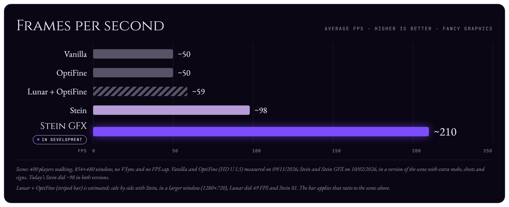

Cada imagen que aparece en la pantalla se arma en dos partes de la computadora: el **procesador**, que ejecuta el juego, y la **tarjeta gráfica**, que pinta la imagen. **Stein GFX**, la nueva API gráfica de Stein, cambia la conversación entre los dos.

## Qué es

Minecraft 1.8.9 usa **OpenGL de función fija**, la forma antigua de comunicarse con la tarjeta gráfica: el juego dicta cada paso, uno a la vez, y el driver revisa cada petición antes de seguir. Con 400 jugadores en pantalla, son unas **1.100 peticiones** y **4.100 cambios de textura** por imagen, casi todo en un único núcleo del procesador.

**Stein GFX** es la nueva API gráfica de Stein. Se ubica entre el juego y la tarjeta gráfica: recibe las mismas peticiones del juego, pero, en lugar de enviarlas una por una, **lo organiza todo y lo envía de una sola vez**, mediante OpenGL moderno y, en el futuro, Vulkan.

**Hoy, en Minecraft 1.8.9:**

1. **El juego** envía sus peticiones **una por una**.
2. El **OpenGL de funciones fijas** pasa cada una de ellas.
3. La **tarjeta gráfica** recibe cerca de **1.100 peticiones** por imagen.

**Con Stein GFX:**

1. **El juego** hace las mismas peticiones de siempre.
2. **Stein GFX** lo organiza todo y lo envía **todo junto**.
3. El **OpenGL moderno** (y, pronto, **Vulkan**) lleva a la **tarjeta gráfica** solo **3 peticiones** por imagen.

## Cómo funciona

- **Anota, sin esperar**: las peticiones del juego se registran en lugar de enviarse en el momento.
- **3 dibujos por imagen**: todos los cuerpos, luego todas las armaduras, luego el resto.
- **Texturas guardadas en la tarjeta gráfica**: las skins quedan almacenadas en la tarjeta, sin cambios en cada dibujo.
- **Varios núcleos del procesador**: las posiciones de los jugadores se calculan en paralelo.
- **Shaders propios**: la luz, el color y el brillo se calculan directamente en la tarjeta gráfica.

> **¿Qué es un shader?** Es un pequeño programa que ejecuta la tarjeta gráfica y que calcula el color de cada parte de la imagen. Todo juego moderno usa shaders para dibujar cualquier cosa en pantalla. En Stein GFX, solo **reproducen el aspecto original de 1.8.9**: no son los "shaders" de OptiFine, que cambian el aspecto del juego.

**Hoy, en Minecraft 1.8.9**, el OpenGL de funciones fijas solo sabe seguir recetas hechas, y el juego dicta **cada paso, uno por uno**:

- **En el procesador**, el juego repite para cada parte de cada uno de los 400 jugadores: usa la skin, gira el brazo, enciende la luz, dibuja el brazo, usa la armadura, dibuja la armadura.
- **En OpenGL**, eso se convierte en una cola de "cambia la textura, dibuja, cambia la textura, dibuja", cerca de **1.100 veces**.
- **La tarjeta gráfica** espera cada petición antes de seguir: son **~1.100 dibujos por imagen**.

**Con Stein GFX**, las peticiones del juego se **anotan** y se envían **de una sola vez**:

- **En el procesador**, el juego sigue con la misma lógica (usa la skin, gira el brazo, dibuja), pero cada petición se anota, sin esperar.
- **Stein GFX** organiza lo anotado en listas: **todos los cuerpos**, **todas las armaduras** y **el resto**.
- **El OpenGL moderno** (y, después, Vulkan) entrega esas listas a la tarjeta en **3 dibujos**.
- **La tarjeta gráfica** calcula la imagen con los **shaders de Stein**: son **3 dibujos por imagen**.

## Mejoras hasta ahora

Medidas en un escenario con 400 jugadores, mobs, cofres y carteles:

- **~98 → ~210 FPS** en comparación con el Stein actual.
- **1.100 → 3** peticiones a la tarjeta gráfica por imagen.
- **7,6 → 3,8 ms** de trabajo de la tarjeta gráfica por imagen.

La imagen, la física y el PvP siguen siendo los del juego original. Las animaciones de los jugadores, ahora calculadas por Stein, fueron verificadas y son idénticas a las del juego.

## Próximos pasos

Stein GFX sigue en desarrollo y **no está disponible** en las versiones actuales. Solo pasará a ser el predeterminado cuando sea igual o superior al Stein actual en todos los escenarios probados.

### macOS

Apple dejó de dar soporte a OpenGL en 2018: se quedó en la versión 4.1 y, en las versiones más recientes de macOS, ya ni siquiera tiene un driver propio. Cada petición del juego se traduce a **Metal**, la API gráfica de Apple, mediante una capa antigua y sin mantenimiento. Por ese límite, los efectos visuales opcionales de Stein (como sombras y agua) hoy no funcionan en Mac.

Stein GFX cambia este escenario en dos etapas:

- **OpenGL 4.1 moderno**: Stein GFX ya tiene un modo dentro del límite de Mac, lo que permitirá que los efectos visuales opcionales también funcionen en macOS.
- **Vulkan, más adelante**: en Mac, Vulkan funciona sobre Metal mediante **MoltenVK**, una capa mantenida activamente, en lugar de la traducción heredada de OpenGL.

Así, Stein GFX es el camino hacia un soporte completo de macOS.

### Compatibilidad

Stein es **modular**: será posible **desactivar Stein GFX al iniciar** el juego.

Esto es necesario porque algunos mods que hoy se usan con Stein dependen por completo del OpenGL antiguo y tendrán que ser adaptados por sus desarrolladores para funcionar con Stein GFX. Mientras tanto, el modo actual, con todas las optimizaciones que Stein ya ofrece, sigue disponible.

En algún momento, todavía **sin fecha prevista**, Stein GFX pasará a ser el predeterminado, y el modo antiguo será una **capa secundaria**, con soporte más limitado.
